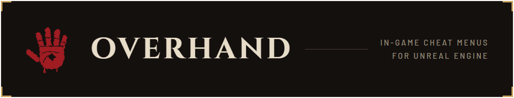
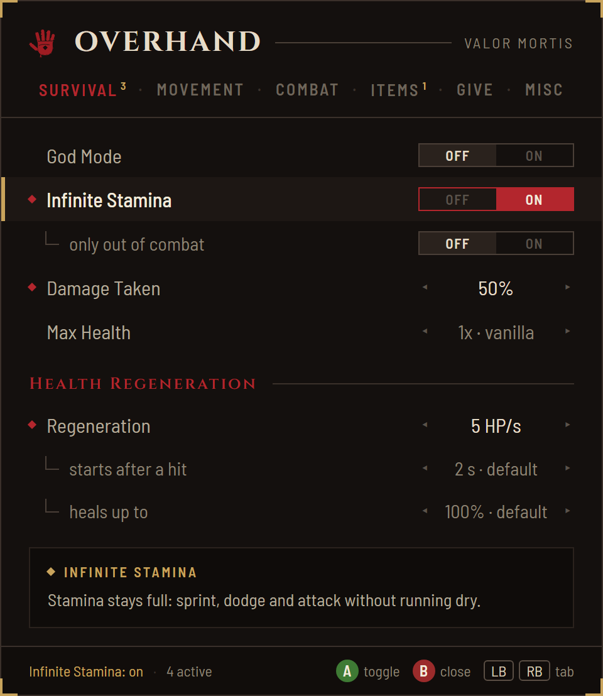

<p align="center">
  
</p>



One menu with every cheat, inside the game, built on [UE4SS](https://github.com/UE4SS-RE/RE-UE4SS). Press **F5**, or click **both sticks** on a controller, pick a tab and change a value.

- **A clean off switch.** Turn a cheat off and the game is exactly as it was before. Nothing runs that you didn't switch on.
- **Controller first, keyboard too.** Full menu control from a gamepad; the footer shows only the buttons that do something on the selected row, for the device you opened it with.
- **Explains itself.** Every row says what it does; the rows you've changed carry a red mark, and each tab counts them.
- **Remembers you.** Your choices are saved for the next session.
- **Light on the game.** Closed, it does next to nothing, and a cheat that's off costs nothing ([details](docs/PERFORMANCE.md)).
- **Safe by default.** One-way actions ask twice; the menu stays out of the way of the game's own menus.
- **Each game looks like itself.** Every game brings its own theme: palette, mark and fonts.

<br clear="right">

## Games

| Game | Engine | Cheats |
|---|---|---|
| [**Valor Mortis**](docs/games/valormortis.md) | UE 5.7 | Survival, movement, teleport, combat, items, give, quests: [see them all](docs/games/valormortis.md#cheats) |

Want another game? [Adding a game](docs/PORTING.md) walks through it.

## Quick start

1. **Install [UE4SS](https://github.com/UE4SS-RE/RE-UE4SS/releases)** for the game. UE 5.6 and newer need the [experimental-latest](https://github.com/UE4SS-RE/RE-UE4SS/releases/tag/experimental-latest) build. Recommended: `bForceGUObjectArrayForIteration = true` in `ue4ss\UE4SS-settings.ini`.
2. **Get Overhand:** clone this repo or download it as a ZIP.
3. **Install it** with the game closed:
   ```powershell
   .\tools\install.ps1 -Game valormortis
   ```
   The installer finds the game in your Steam libraries, Xbox app / Game Pass folders (any drive), Epic Games and GOG installs.
4. **Play.** Load a save and press **F5** (or **L3 + R3**).

<details>
<summary><b>More install options</b></summary>

```powershell
.\tools\install.ps1 -Game valormortis -GameDir "E:\Games\Valor Mortis"   # when it isn't found, or is installed twice
.\tools\install.ps1 -Game valormortis -Uninstall
.\tools\install.ps1 -Game valormortis -BuildOnly                           # only assemble build\valormortis\Overhand\
```

`-GameDir` takes the game's folder, its `Content` folder (Xbox app) or its `Binaries\Win64` folder. The installer puts the mod in UE4SS's Mods folder (`ue4ss\Mods`, or `Mods` for older UE4SS) and keeps your settings and teleports across installs. A game update or a store's "repair" / "verify files" can remove UE4SS and the mod: install again afterwards.

What gets installed, built from only what that game needs:

```
Mods\Overhand\
  Scripts\main.lua    src\main.lua
  Scripts\core\       src\core\
  Scripts\gas\        src\gas\           (only for games that use GAS)
  Scripts\game\       games\<game>\      (only that game)
  assets\             assets\            (the menu's mark, arrows, button disc, fonts)
```

</details>

<details>
<summary><b>Files it writes</b></summary>

All inside `Mods\Overhand\`:

| File | |
|---|---|
| `settings.cfg` | your settings, plain `key=value` text |
| `teleports.txt` | saved positions (if the game has teleports) |
| `Overhand.log`, `.log.old` | this session and the previous one |
| `Overhand-BugReport.txt` | only when you press *Write bug report* |
| `Overhand-ButtonIcons.txt` | only when you press *Find controller button icons* |
| `Overhand-<report>.txt` | only when you press a game's own report action |

</details>

## Controls

| Keyboard | Controller | |
|---|---|---|
| **F5** | **L3 + R3** (click both sticks) | open / close |
| **↑ / ↓** | **D-pad ↑ / ↓** | select a row (hold to repeat) |
| **← / →** | **D-pad ← / →** | change the value (hold to repeat) |
| **Enter** | **A** | toggle, run an action, or open a list |
| **Q / E** | **LB / RB** | previous / next tab |
| **Esc** | **B** | close (or leave a list) |

In an open list, **← / →** moves a page. While the menu is open your character doesn't move, look around or act. The menu won't open over a game menu and closes itself when one appears.

## Under the hood

```
src/main.lua      entry point
src/core/         the menu, input, settings, logging, safe Unreal access, the per-tick loop
src/gas/          Gameplay Ability System helpers (any GAS game)
games/<game>/     one folder per game: wiring, game access, features, menu content, manifest
```

One repo holds the shared framework and every game; installing builds a mod for **one** game. Layers only point down: `core` knows no game and no GAS, `gas` knows no game. Each cheat is a small feature module whose tick applies your settings; the menu only writes settings. More in [Architecture](docs/ARCHITECTURE.md).

## Contributing

```powershell
pip install lupa
python tools\smoke_test.py               # every game
python tools\smoke_test.py valormortis   # one game
```

The smoke test assembles each game's mod like the installer, compiles it with Lua 5.4 (what UE4SS embeds), checks the layers, and runs it against mocked UE4SS: the main menu, a loaded save with the features ticking, every row of every tab with keyboard and controller, a map change and a first start. It catches syntax, wiring and load errors; game behaviour still needs the game.

| Docs | |
|---|---|
| [Architecture](docs/ARCHITECTURE.md) | Layers, how a game's mod is assembled, every module, the rules |
| [Adding a game](docs/PORTING.md) | A new game, step by step (worked example: Atomic Heart) |
| [Discovery](docs/DISCOVERY.md) | Finding a game's internals with UE4SS: dumps, Live View, hooks, testing, pitfalls |
| [Performance](docs/PERFORMANCE.md) | What costs what, and the per-path budget |
| [Valor Mortis](docs/games/valormortis.md) | The game's cheats and internals: classes, attributes, damage functions, effects, items, menus |
| [Changelog](CHANGELOG.md) | Every version |

## Credits

- Parts of the Valor Mortis cheat logic come from **Valor Mortis Cheat Menu** 1.3.2 by BryanHudson (MIT), and several 1.6.0 features follow its 1.4.0 findings, reimplemented.
- Valor Mortis Health Regeneration (healing through the game's attribute system, the combat check) and Damage Taken (raising resistances) follow **AeonGreyh**'s Passive Health Regen and Defense Multiplier, reimplemented here.
- [UE4SS](https://github.com/UE4SS-RE/RE-UE4SS) by the UE4SS-RE team (MIT).
- Fonts: [Cinzel](https://github.com/NDISCOVER/Cinzel) by Natanael Gama and [Barlow](https://github.com/jpt/barlow) by Jeremy Tribby, both under the SIL Open Font License 1.1 (`assets/fonts/`).

## License

MIT. See [LICENSE](LICENSE).
